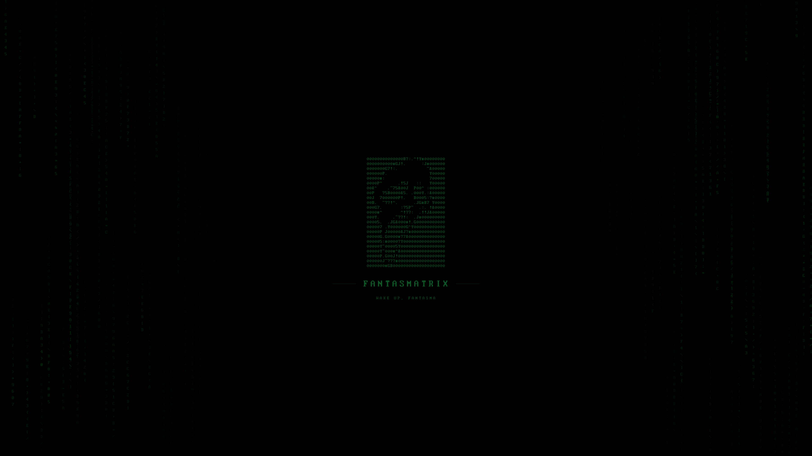

# Fantasmatrix para Omarchy

Tema preto e verde Matrix, com menus escuros, contornos finos e wallpaper
Ghostface em ASCII. Derivado da paleta da skin Fantasmatrix: acento `#00FF00`,
superfícies `#000500`/`#001A00` e seleção `#003300`.



Validado no Omarchy **4.0.6-1**, com Hyprland **0.56.2** e Omarchy Shell.
Outras distribuições e versões anteriores do Omarchy precisam de adaptação,
principalmente para o shell e a configuração Lua do Hyprland.

## Instalar pela URL

```bash
omarchy theme install https://github.com/fantasmagorikus/omarchy-fantasmatrix-theme.git
```

O comando instala e ativa o tema como **Fantasmatrix**. Na versão validada,
se já existir `~/.config/omarchy/themes/fantasmatrix`, essa pasta será substituída:
faça uma cópia dela antes de reinstalar se contiver ajustes pessoais.

O Omarchy gera as cores dos aplicativos a partir de `colors.toml`.
O arquivo `shell.toml` define o estilo da barra, menus, notificações e bloqueio.
O wallpaper já está incluído; os ícones usam `Yaru-sage`, disponível na
instalação Omarchy em que o tema foi validado.

Temas instalados por Git não carregam o `hyprland.lua` fornecido pelo repositório.
As cores das bordas continuam funcionando, mas o tamanho das bordas e os
espaçamentos seguem as configurações da máquina de destino.

## Instalar o pacote ZIP com a geometria completa

[Baixar o ZIP](https://github.com/fantasmagorikus/omarchy-fantasmatrix-theme/archive/refs/heads/main.zip).

O ZIP inclui `hyprland.lua`: borda de 1 px, espaço interno de 4 px, externo
de 8 px e cantos retos. Leia o arquivo antes de aplicar esta configuração local.

1. Extraia o ZIP.
2. Copie a pasta extraída para `~/.config/omarchy/themes/fantasmatrix-local`.
   Crie `~/.config/omarchy/themes` se necessário. Se o destino já existir,
   use outro nome ou faça uma cópia antes; não misture as pastas.
3. Aplique:

```bash
omarchy theme set fantasmatrix-local
hyprctl reload
hyprctl configerrors
```

Se a opção sem bordas estiver ativa, ela tem prioridade. Para mostrar as
bordas e os espaços do tema:

```bash
omarchy hyprland toggle window-no-gaps off
hyprctl configerrors
```

## Transparência de 80%

A transparência do terminal não é importada pelo comando de tema. Para Kitty,
faça uma cópia de `~/.config/kitty/kitty.conf` e ajuste a opção existente:

```conf
background_opacity 0.20
dynamic_background_opacity yes
```

Se houver atalhos ou scripts que definem opacidade, ajuste o valor deles para
`0.20` também. Depois execute `omarchy restart terminal`.

Para a barra verde com 80% de transparência, faça uma cópia de
`~/.config/omarchy/shell.json` e defina somente `bar.transparent` como `false`.
Isso permite que o shell use `background-alpha = 0.20` deste tema; o modo
`transparent: true` deixa a barra totalmente transparente e escolhe a cor
do texto automaticamente. O arquivo é recarregado ao salvar.

As preferências locais de fonte, tamanho, posição da barra, plugins e atalhos
continuam tendo prioridade. Este pacote contém apenas os arquivos do tema;
os aplicativos Hermes/Herdr e as configurações pessoais do terminal não estão incluídos.

## Referências

- [Criar e distribuir temas Omarchy](https://github.com/omacom/omarchy/blob/quattro/manual/43-making-your-own-theme.md)
- [Criar repositório no GitHub](https://docs.github.com/en/repositories/creating-and-managing-repositories/creating-a-new-repository)
- [Enviar arquivos ao GitHub](https://docs.github.com/en/repositories/working-with-files/managing-files/adding-a-file-to-a-repository)
